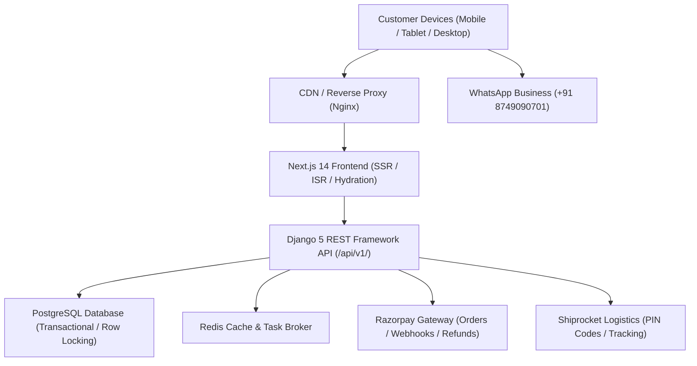

# Madhu Silks — Full-Stack Technical Architecture

## 1. System Overview
**Madhu Silks** is an authentic, production-grade Indian saree e-commerce platform built strictly for saree retailing, originating from **Jakribettu, Bantwal, Karnataka**.

The architecture decouples the high-performance user-facing presentation tier from the transactional business tier:
- **Frontend Presentation Layer**: Next.js 14 App Router, TypeScript, Tailwind CSS, Zustand, React Hook Form, Zod.
- **Backend Application Layer**: Python 3.12, Django 5, Django REST Framework (DRF), WhiteNoise, OpenAPI/Swagger (drf-spectacular).
- **Persistence & Processing**: PostgreSQL (with SQLite zero-config local fallback), Redis, Celery.
- **E-Commerce Integrations**: Razorpay (Orders, Signatures, Webhooks, Refunds), WhatsApp Business API & Click-to-Chat, Shiprocket Logistics, Cloudinary Image CDN.

## 2. Core Architectural Principles
1. **Strict Business Rule Compliance**: Madhu Silks sells **ONLY** sarees. No dresses, kurtis, or western garments are modeled or permitted.
2. **Deterministic Financial Accuracy**: All monetary figures are stored and calculated as **integer paise** (`price_paise`, `total_amount_paise`) to eliminate IEEE 754 floating-point rounding errors.
3. **Inventory Concurrency Protection**: High-demand bridal and handloom sarees are protected against overselling through database atomic transactions and row-level locking (`select_for_update()`).
4. **Resilient Local Development**: Fully functional locally with zero required external dependencies (automatic fallback SQLite database, mock payment handlers, and offline seeded saree drapes).

